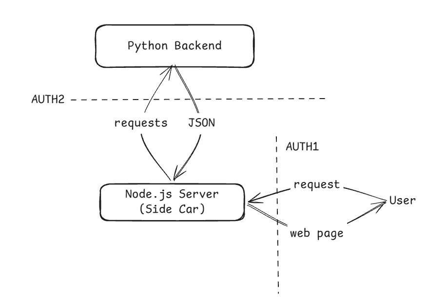

Lets' first build the React Frontend and set up some basic RBAC/authentication and deploy it to GCP

Figured out we need Server-side rendering for SEO optimization, loading efficiency and most importantly from a security standpoint safeguarding business logic and internal endpoints

*Note for future: Build security against DDoS attacks to protect the rendering server*

Gemini suggests to use a side car architecture for react/javascript rendering and python backend..
One concern I think is how do I propogate my user authentication along different service boundries, or do I even need to do that ??

Okay, the auth 2 is not neccessary here since backend can always trust our rendering server.. can make them sit in VPC (but there must be some things to be taken care of, will look into it later)